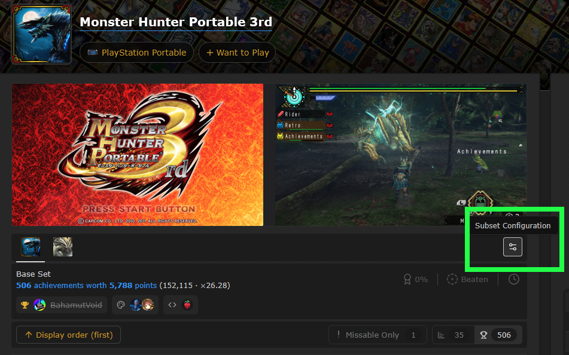

# AdrenalineRA

RetroAchievements support for Adrenaline on the PS Vita.

AdrenalineRA is not an emulator. It runs inside Adrenaline 8.0.2 and uses
Adrenaline's own menu, notifications and display path, so achievements, leaderboards
and rich presence behave like part of the system rather than an external overlay.

- Version: 1.0.0
- Platform: PS Vita 3.60+ (Tested on 3.60 only)
- Base: Adrenaline 8.0.2
- Modes: PSP games and PS1 games through POPS

This project tracks Adrenaline by isage and adds RetroAchievements on top of it.
Testing was done on a PS Vita, with PSP games running natively and PS1 games
running through POPS.

> **Eligibility notice**
>
> AdrenalineRA is still undergoing eligibility review with RetroAchievements.
> This review may take some time. Until it is complete, Hardcore mode and
> leaderboards will not be available. Enabling Hardcore currently downgrades
> the session to Casual automatically, so it is not advisable to enable it
> until eligibility is obtained. The implementation is already in the code;
> it only needs RetroAchievements acknowledgement.

> **AI use notice**
>
> AI tools were used for coding, debugging, analysis, code review and helper programs.
> The implementation and hardware testing were done by the author. The project has
> been rigorously tested on hardware, with particular care around Hardcore
> gating, session ownership, offline handling, disc switching, and the
> menu/display path.

## Features

- Achievement lists, subsets, points, progress, missable markers and tooltips
- Unlock notifications with badge art and sound
- Leaderboards, attempt tracking and result cards
- Rich presence and active progress indicators
- Badge and game artwork caching
- Automatic screenshots on unlock
- Hardcore and Casual sessions, Encore, spectator mode and unofficial achievements
- Per-page options for notifications, badges, indicators, screenshots, and sound
- PSP and POPS support, including Multi-disk titles

### Achievement subsets

Subsets such as bonus, challenge and specialty sets are supported and can be selected
from the achievement-set picker. Which subsets a game includes by default, and whether
a subset should be removed, is controlled on the RetroAchievements website. There is no
client-side setting that overrides the site's subset configuration.

On the game page, use **Subset Configuration** to choose which subsets are included:



### PSP and POPS

PSP mode is the primary and most tested path. POPS support covers PS1 EBOOTs, PS1
memory access, achievements, leaderboards, rich presence and screenshots.

POPS has had less testing than PSP mode. Most hardware testing focused on native
PSP titles. The POPS EBOOTs used for testing were created with **pop-fe**; no
other EBOOT-creation tool was used.

## Requirements

- PS Vita on firmware 3.60 or newer, with taiHEN/CFW suitable for Adrenaline
- Adrenaline 8.0.2 with its PSP 6.61 firmware installed
- The matching `systemctrl.prx` and `pentazemin.prx` modules. The VPK ships both;
  Hardcore plugin enforcement and the Adrenaline CFW gate depend on them
- A RetroAchievements account
- Modern TLS support plugins like iTLS-Enso (3.60)

No game images, firmware, keys or account credentials are included.

## Installation

1. Install the release vpk file with VitaShell and open Adrenaline.
   On a fresh install, put `661.PBP` in `ux0:app/PSPEMUCFW/` before opening Adrenaline.
   After installation the flash files are written under `ux0:data/PSPEMUCFW/*`.
   When prompted to boot into the PSP XMB, decline it,
   open the Adrenaline menu via holding the PS button
   and then Exit PspEmu Application.
2. Launch Adrenaline again to install the modules.
   The release includes both `systemctrl.prx` and `pentazemin.prx`. On launch,
   Adrenaline copies them to `ux0:{data,app}/PSPEMUCFW/flash0/kd/` when the
   matching module is missing or stale, so no manual copy is needed. The separate
   release files remain available for repair.
3. **Restart your PS Vita after installation.**; the CFW and the `systemctrl`/`pentazemin` modules
   are not active until the Vita has restarted.
4. In the XMB, open the Adrenaline menu and press the shoulder buttons to the RA tab.
5. Sign in under **Account**.
6. Open **Options** to configure notifications, screenshots, sound, and
   other preferences.

## Building

The full source is in this repository. You need the VitaSDK toolchain, CMake, Ninja
and network access for CMake to fetch the vita2d FBO fork and shader collection.

The commands below use POSIX shell syntax. On Windows, run them from a shell
that can invoke the VitaSDK tools, or adapt the environment variables to that
shell.

```sh
export VITASDK=/path/to/vitasdk
export PATH="$VITASDK/bin:$PATH"

cmake -S third_party/Adrenaline -B ../../out/prod-build -G Ninja \
  -DCMAKE_BUILD_TYPE=Release \
  -DCMAKE_TOOLCHAIN_FILE="$VITASDK/share/vita.toolchain.cmake"

cmake --build ../../out/prod-build --target Adrenaline.vpk-vpk -j4
```

The VPK is written to `../../out/prod-build/bubble/Adrenaline.vpk`.

The release build uses `out/prod-build`, which contains the pinned
`libvita2dfbo` and `vitashadercollection` dependencies. That directory is not
part of the source package. On a clean checkout, create it and build the
`libvita2dfbo` and `vitashadercollection` targets first; the vita2d fork must be
able to resolve its `fbo` branch.

`Release` is required: without it the rcheevos build can fail on its assertion
runtime.

If the linker reports an EABI mismatch on a path-mounted checkout, add
`-DCMAKE_C_FLAGS="-Wl,--no-warn-mismatch"` to the configure command.

If Git rejects the fetched `libvita2dfbo` directory as "dubious ownership" on a
WSL or path-mounted checkout, allow that build directory:

```sh
git config --global --add safe.directory "$(pwd)/../../out/prod-build/user/libvita2dfbo"
```

Rebuilding `systemctrl.prx` or `pentazemin.prx` is optional and needs a PSP CFW
toolchain. The prebuilt files are under
`third_party/Adrenaline/user/flash0/kd/`.

## Project layout

```text
app/                       Vita-facing runtime, menu, notify, badge, shot, sound, text
core/                      portable session, server, hash, settings, offline, netqueue, log, arena
platform/                  Vita adapters and compatibility
assets/ra_sounds/          generated notification sounds (CC0)
third_party/Adrenaline/    Adrenaline 8.0.2 fork and integration hooks
third_party/rcheevos/      RetroAchievements runtime
third_party/mbedtls/       TLS and crypto
third_party/puff/          inflate implementation (public domain)
```

## Reporting issues

Open an issue and include:

1. A save file that is near the point of unlock and reproduces the problem.
2. Game name, game ID/region and whether it is a PSP or POPS game.
3. AdrenalineRA version, Adrenaline version and PS Vita firmware.
4. Steps to reproduce.

Without a save file, the problem may not be reproducible.

## Testing

Host tests cover the portable `core/` code: settings, vault, server, hash, session
and the related parsers. The suite passes 24/24.

The Vita-facing `app/` and `platform/` layers run inside Adrenaline and are not covered by the host suite. They are validated on hardware; runtime, menu, notify and badge behavior has no host-level coverage.


## Privacy

AdrenalineRA does not operate its own servers and includes no telemetry,
analytics, advertising or third-party trackers.

When signed in, the RetroAchievements username and API token are stored in an
encrypted local vault under `ur0`. Game hashes, achievement progress,
leaderboard entries and rich presence are sent to RetroAchievements over HTTPS.
Local logs, caches and screenshots stay on the Vita and are not uploaded
automatically. Signing out removes the local credentials.

Local data is retained until you delete it or sign out. Data held by
RetroAchievements, including its retention periods, server locations and GDPR
handling, is governed by the RetroAchievements privacy policy:

https://retroachievements.org/privacy

## License

AdrenalineRA is released under the **GNU General Public License v3.0**. See
`LICENSE`.

Adrenaline is GPL-3.0, rcheevos is MIT and Mbed TLS is used under Apache-2.0. The
corresponding license files are kept under `third_party/`.
